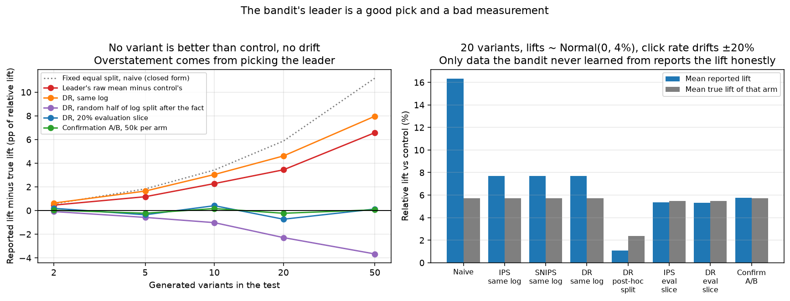

# Generated creatives and a bandit: simulation results

<!-- Generated by scripts/bandit_eval_sim.py. Do not edit by hand. -->

Reproduce from a clean checkout:

```bash
pip install -e ".[dev]"
python scripts/bandit_eval_sim.py
```

The full run takes about 33 minutes on a laptop CPU (`--smoke` takes seconds).

## Setup

Seed `20261127`. No model API calls. The incumbent creative (control) has click rate 5%. A test runs 480,000 impressions in 12 batches of 40,000. The control keeps a fixed 20% of traffic. Batched Thompson sampling with a Beta(10, 190) prior (centred on the incumbent's rate) allocates the rest across the generated variants, with 20% of variant traffic spread uniformly as a floor. The allocation probabilities are logged and are the exact assignment probabilities. With drift, every arm's click rate is multiplied by a factor that rises linearly from 0.8 to 1.2 over the test (it averages 1); the bandit assumes rates are constant. Variant lifts are relative and constant over time.

The bandit's pick (the "leader") is the variant with the highest final posterior mean. Each replication simulates two bandits on the same variants:

- **A standard bandit** that learns from every impression. Same-log estimators evaluate its leader on the log that chose it. The post-hoc split divides that log into random halves, picks the variant with the highest SNIPS value on one half, and evaluates it on the other. The confirmation A/B is a fresh 50/50 test of its leader against control with 50,000 impressions per arm, run after the bandit at the average click rate.
- **A bandit with an evaluation slice**: a random 20% of every batch is served with the same probabilities, but those clicks are never fed back to the bandit. Its leader is evaluated on the slice only. The slice uses 96,000 impressions, about the size of the confirmation A/B, but needs no extra traffic or time.

DR uses the bandit's posterior mean at decision time as its outcome model.

All lifts are relative to the control's true click rate. Bias is the mean of (estimate − true lift of the arm being evaluated). "Claims a win" means the 95% CI is entirely above zero; "false win" means it claims a win and the arm's true lift is ≤ 0. Monte Carlo SE of a rate near 0.05 is about 0.007 in section 1 and 0.011 in sections 2 and 3.



## 1. Every estimator against the truth (20 variants, 1,000 replications)

Mean true lift of the best variant: Every variant equals the control, drift none: +0.0%; Every variant equals the control, drift ±20%: +0.0%; Variant lifts ~ Normal(0, 4%), drift none: +7.5%; Variant lifts ~ Normal(0, 4%), drift ±20%: +7.4%.

| Variants' true lifts | Click-rate drift | Estimator | Mean estimate | Mean true lift of evaluated arm | Bias | RMSE | Mean SE | 95% CI coverage | Claims a win | False win |
|---|---|---|---:|---:|---:|---:|---:|---:|---:|---:|
| Every variant equals the control | none | Leader's raw mean minus control's | +3.5% | +0.0% | +3.5% | 3.9% | 2.8% | 0.839 | 0.161 | 0.161 |
| Every variant equals the control | none | IPS, same log | +4.6% | +0.0% | +4.6% | 5.2% | 3.5% | 0.785 | 0.215 | 0.215 |
| Every variant equals the control | none | SNIPS, same log | +4.6% | +0.0% | +4.6% | 5.2% | 3.4% | 0.773 | 0.227 | 0.227 |
| Every variant equals the control | none | DR, same log | +4.6% | +0.0% | +4.6% | 5.2% | 3.4% | 0.775 | 0.225 | 0.225 |
| Every variant equals the control | none | DR, random half of log split after the fact | -2.1% | +0.0% | -2.1% | 6.4% | 5.8% | 0.943 | 0.010 | 0.010 |
| Every variant equals the control | none | IPS, 20% evaluation slice | -0.5% | +0.0% | -0.5% | 7.5% | 7.7% | 0.955 | 0.013 | 0.013 |
| Every variant equals the control | none | DR, 20% evaluation slice | -0.4% | +0.0% | -0.4% | 7.2% | 7.5% | 0.958 | 0.012 | 0.012 |
| Every variant equals the control | none | Confirmation A/B, 50k per arm | +0.2% | +0.0% | +0.2% | 2.9% | 2.8% | 0.937 | 0.036 | 0.036 |
| Every variant equals the control | ±20% | Leader's raw mean minus control's | +12.6% | +0.0% | +12.6% | 12.8% | 2.2% | 0.000 | 1.000 | 1.000 |
| Every variant equals the control | ±20% | IPS, same log | +3.8% | +0.0% | +3.8% | 4.4% | 3.6% | 0.914 | 0.086 | 0.086 |
| Every variant equals the control | ±20% | SNIPS, same log | +3.8% | +0.0% | +3.8% | 4.4% | 3.5% | 0.917 | 0.083 | 0.083 |
| Every variant equals the control | ±20% | DR, same log | +3.8% | +0.0% | +3.8% | 4.4% | 3.5% | 0.918 | 0.082 | 0.082 |
| Every variant equals the control | ±20% | DR, random half of log split after the fact | -1.4% | +0.0% | -1.4% | 8.2% | 7.7% | 0.930 | 0.019 | 0.019 |
| Every variant equals the control | ±20% | IPS, 20% evaluation slice | -0.1% | +0.0% | -0.1% | 8.2% | 8.0% | 0.946 | 0.017 | 0.017 |
| Every variant equals the control | ±20% | DR, 20% evaluation slice | -0.1% | +0.0% | -0.1% | 8.0% | 7.8% | 0.942 | 0.020 | 0.020 |
| Every variant equals the control | ±20% | Confirmation A/B, 50k per arm | -0.1% | +0.0% | -0.1% | 2.7% | 2.8% | 0.955 | 0.016 | 0.016 |
| Variant lifts ~ Normal(0, 4%) | none | Leader's raw mean minus control's | +7.7% | +6.7% | +1.1% | 2.4% | 2.2% | 0.936 | 0.872 | 0.000 |
| Variant lifts ~ Normal(0, 4%) | none | IPS, same log | +8.7% | +6.7% | +2.0% | 3.3% | 2.9% | 0.914 | 0.823 | 0.000 |
| Variant lifts ~ Normal(0, 4%) | none | SNIPS, same log | +8.7% | +6.7% | +2.0% | 3.2% | 2.8% | 0.910 | 0.829 | 0.000 |
| Variant lifts ~ Normal(0, 4%) | none | DR, same log | +8.7% | +6.7% | +2.0% | 3.2% | 2.8% | 0.909 | 0.829 | 0.000 |
| Variant lifts ~ Normal(0, 4%) | none | DR, random half of log split after the fact | +1.2% | +3.1% | -1.9% | 6.2% | 5.5% | 0.931 | 0.180 | 0.001 |
| Variant lifts ~ Normal(0, 4%) | none | IPS, 20% evaluation slice | +6.4% | +6.4% | +0.0% | 6.4% | 6.6% | 0.957 | 0.205 | 0.000 |
| Variant lifts ~ Normal(0, 4%) | none | DR, 20% evaluation slice | +6.5% | +6.4% | +0.1% | 6.4% | 6.4% | 0.954 | 0.226 | 0.000 |
| Variant lifts ~ Normal(0, 4%) | none | Confirmation A/B, 50k per arm | +6.7% | +6.7% | +0.0% | 2.9% | 2.8% | 0.941 | 0.602 | 0.000 |
| Variant lifts ~ Normal(0, 4%) | ±20% | Leader's raw mean minus control's | +16.3% | +5.7% | +10.6% | 11.1% | 2.0% | 0.009 | 1.000 | 0.032 |
| Variant lifts ~ Normal(0, 4%) | ±20% | IPS, same log | +7.7% | +5.7% | +2.0% | 3.2% | 3.0% | 0.943 | 0.685 | 0.005 |
| Variant lifts ~ Normal(0, 4%) | ±20% | SNIPS, same log | +7.7% | +5.7% | +2.0% | 3.1% | 2.9% | 0.938 | 0.692 | 0.006 |
| Variant lifts ~ Normal(0, 4%) | ±20% | DR, same log | +7.7% | +5.7% | +2.0% | 3.1% | 2.9% | 0.938 | 0.693 | 0.006 |
| Variant lifts ~ Normal(0, 4%) | ±20% | DR, random half of log split after the fact | +1.1% | +2.4% | -1.3% | 8.0% | 7.7% | 0.940 | 0.078 | 0.001 |
| Variant lifts ~ Normal(0, 4%) | ±20% | IPS, 20% evaluation slice | +5.3% | +5.5% | -0.2% | 7.1% | 6.9% | 0.950 | 0.156 | 0.001 |
| Variant lifts ~ Normal(0, 4%) | ±20% | DR, 20% evaluation slice | +5.3% | +5.5% | -0.2% | 7.0% | 6.7% | 0.952 | 0.171 | 0.001 |
| Variant lifts ~ Normal(0, 4%) | ±20% | Confirmation A/B, 50k per arm | +5.8% | +5.7% | +0.1% | 2.7% | 2.8% | 0.955 | 0.529 | 0.000 |

## 2. More variants, bigger winner's curse (no drift, 400 replications per row)

### 2a. Every variant equals the control

The closed-form column is the winner's-curse bias if the variant traffic were split equally and never reallocated (`expected_winner_bias_fixed`), for reference.

| Variants | Fixed equal split, naive (closed form) | Leader's raw mean minus control's: bias | DR, same log: bias | DR, random half of log split after the fact: bias | DR, 20% evaluation slice: bias | Confirmation A/B, 50k per arm: bias | DR, same log: false win | DR, random half of log split after the fact: false win | DR, 20% evaluation slice: false win | Confirmation A/B, 50k per arm: false win |
|---:|---:|---:|---:|---:|---:|---:|---:|---:|---:|---:|
| 2 | +0.6% | +0.5% | +0.6% | -0.1% | +0.2% | +0.0% | 0.037 | 0.022 | 0.030 | 0.020 |
| 5 | +1.8% | +1.2% | +1.6% | -0.6% | -0.4% | -0.2% | 0.058 | 0.015 | 0.020 | 0.015 |
| 10 | +3.4% | +2.3% | +3.0% | -1.0% | +0.4% | +0.2% | 0.168 | 0.013 | 0.028 | 0.020 |
| 20 | +5.9% | +3.4% | +4.6% | -2.3% | -0.7% | -0.2% | 0.193 | 0.007 | 0.013 | 0.018 |
| 50 | +11.2% | +6.6% | +8.0% | -3.7% | +0.1% | +0.1% | 0.255 | 0.005 | 0.028 | 0.050 |

### 2b. Variant lifts ~ Normal(0, 4%): what the evaluation slice costs

| Variants | Best variant's true lift | True lift of leader, bandit learns from everything | True lift of leader, bandit with evaluation slice | DR, same log: bias | DR, 20% evaluation slice: bias | DR, 20% evaluation slice: coverage | DR, 20% evaluation slice: mean SE | Confirmation A/B, 50k per arm: mean SE |
|---:|---:|---:|---:|---:|---:|---:|---:|---:|
| 2 | +2.4% | +2.3% | +2.3% | +0.1% | +0.0% | 0.953 | 3.7% | 2.8% |
| 5 | +4.8% | +4.6% | +4.5% | +0.4% | -0.2% | 0.943 | 4.1% | 2.8% |
| 10 | +6.2% | +5.7% | +5.6% | +1.0% | +0.4% | 0.945 | 5.0% | 2.8% |
| 20 | +7.4% | +6.5% | +6.3% | +2.1% | -0.1% | 0.950 | 6.4% | 2.8% |
| 50 | +9.0% | +6.9% | +6.6% | +5.0% | -0.7% | 0.945 | 10.4% | 2.8% |

## 3. A thin propensity floor costs the evaluation slice its coverage (20 variants, lifts ~ Normal(0, 4%), drift ±20%, 400 replications per row)

| Uniform floor (share of variant traffic) | Smallest propensity | Estimator | Bias | Emp. SD | Mean SE | 95% CI coverage |
|---:|---:|---|---:|---:|---:|---:|
| 20% | 0.0080 | IPS, 20% evaluation slice | -0.1% | 6.6% | 6.9% | 0.955 |
| 20% | 0.0080 | DR, 20% evaluation slice | -0.1% | 6.5% | 6.8% | 0.948 |
| 5% | 0.0020 | IPS, 20% evaluation slice | +0.2% | 7.9% | 7.3% | 0.950 |
| 5% | 0.0020 | DR, 20% evaluation slice | +0.2% | 7.6% | 7.1% | 0.948 |
| 1% | 0.0004 | IPS, 20% evaluation slice | -0.1% | 9.5% | 8.3% | 0.910 |
| 1% | 0.0004 | DR, 20% evaluation slice | -0.0% | 9.2% | 8.1% | 0.917 |
| 0% | 0 (no floor) | IPS, 20% evaluation slice | -0.8% | 9.0% | 7.8% | 0.922 |
| 0% | 0 (no floor) | DR, 20% evaluation slice | -0.6% | 8.9% | 7.7% | 0.930 |
