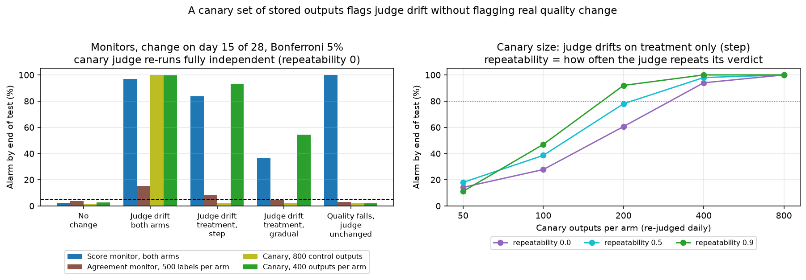

# Canary-set drift monitor: simulation results

<!-- Generated by scripts/canary_drift_sim.py. Do not edit by hand. -->

Reproduce from a clean checkout:

```bash
pip install -e ".[dev]"
python scripts/canary_drift_sim.py
```

Seed `20261127`. No model API calls. The test and scenarios are the same as in [`silent_drift_results.md`](silent_drift_results.md): 28 days, 500 units per arm per day, control quality rate 0.60, no true effect. The judge starts at sensitivity = specificity = 0.85; from day 15, with no version flag, its specificity drops to 0.75 on the arms named, at once (step) or linearly until day 28 (gradual). In the last scenario the judge never changes but true quality falls by 0.08 on both arms from day 15.

A *canary set* is a fixed set of stored outputs, saved before the change, that the production judge re-scores every day. Their true quality never changes, so only a judge change can move their scores. No human labels are used. The canary monitor compares each output's mean verdict over the latest 7 days with its own mean over the first 7 days, and tests the mean of those paired differences across outputs. Every monitor checks daily from day 14 to day 28 (15 checks) with a Bonferroni threshold over every check and series, so the chance of any false alarm is at most 0.05 when the judge doesn't change. The score and agreement monitors are loop 11's: the judge pass rate on all units of each arm, and in each arm the judge pass rate among the 500 randomly labeled units humans passed and among those humans failed. *Repeatability* is how often the judge gives a stored output the same verdict on different days (0 = a fresh, independent verdict each day; 1 = fully deterministic). It doesn't change the judge's error rates. Section 1 uses 0, the worst case for the canary. "Median days after change" counts the changed days seen when the alarm fires (day of alarm − 14). Monte Carlo SE of a rate near 0.05 is about 0.005.



## 1. Monitors against known drift (2,000 replications, repeatability 0)

The canary with control outputs only re-judges the same number of outputs per day (800) as the canary with 400 outputs per arm. Closed form for one check on a fully drifted week, 400 treatment outputs: the canary flags with probability 0.773.

| Scenario | Score monitor, both arms: alarm rate | Score monitor, both arms: median days after change | Agreement monitor, 500 labels per arm: alarm rate | Agreement monitor, 500 labels per arm: median days after change | Canary, 800 control outputs: alarm rate | Canary, 800 control outputs: median days after change | Canary, 400 outputs per arm: alarm rate | Canary, 400 outputs per arm: median days after change |
|---|---:|---:|---:|---:|---:|---:|---:|---:|
| No change | 0.025 | — | 0.036 | — | 0.018 | — | 0.028 | — |
| Judge drifts on both arms (step) | 0.971 | 6 | 0.153 | 8 | 1.000 | 4 | 0.996 | 5 |
| Judge drifts on treatment only (step) | 0.838 | 6 | 0.086 | 8 | 0.020 | 3 | 0.932 | 6 |
| Judge drifts on treatment only (gradual) | 0.363 | 12 | 0.043 | 8 | 0.022 | 5 | 0.543 | 12 |
| True quality falls, judge unchanged | 1.000 | — | 0.032 | — | 0.019 | — | 0.021 | — |

## 2. Canary size (500 replications per cell)

Judge calls per day count both arms. With fully independent re-judging, one check on a fully drifted week flags with 80% probability at 420 canary outputs per arm (closed form).

| Canary outputs per arm | Judge calls per day | Treatment-only drift, repeatability 0.0: alarm rate (median days) | Treatment-only drift, repeatability 0.5: alarm rate (median days) | Treatment-only drift, repeatability 0.9: alarm rate (median days) | No change, repeatability 0.0: alarm rate | No change, repeatability 0.9: alarm rate | One fully drifted week flags, repeatability 0.0 (closed form) |
|---:|---:|---:|---:|---:|---:|---:|---:|
| 50 | 100 | 0.142 (8) | 0.180 (10) | 0.112 (7) | 0.024 | 0.012 | 0.039 |
| 100 | 200 | 0.278 (7) | 0.386 (8) | 0.470 (7) | 0.034 | 0.006 | 0.115 |
| 200 | 400 | 0.606 (7) | 0.780 (7) | 0.920 (5) | 0.020 | 0.016 | 0.347 |
| 400 | 800 | 0.940 (6) | 0.980 (5) | 1.000 (4) | 0.020 | 0.028 | 0.773 |
| 800 | 1,600 | 1.000 (4) | 1.000 (4) | 1.000 (3) | 0.018 | 0.012 | 0.991 |
