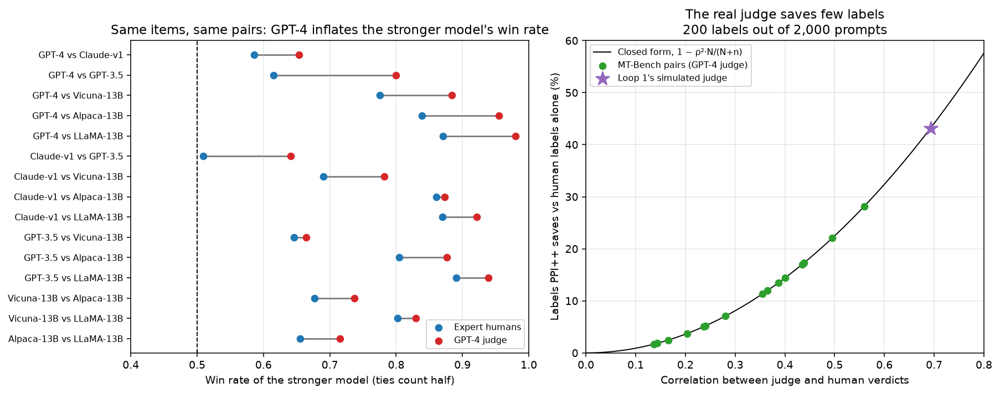

# Real-data judge audit: MT-Bench human vs GPT-4 judgments

<!-- Generated by scripts/judge_audit_mtbench.py. Do not edit by hand. -->

Reproduce from a clean checkout (downloads about 1.4 MB on first run):

```bash
pip install -e ".[dev,data]"
python scripts/judge_audit_mtbench.py
```

**Data.** MT-Bench human judgments, Zheng et al. (2023), *Judging LLM-as-a-judge with MT-Bench and Chatbot Arena*, released under CC BY 4.0 at [lmsys/mt_bench_human_judgments](https://huggingface.co/datasets/lmsys/mt_bench_human_judgments) (revision `f7d2896`). It is downloaded at runtime and checked against pinned SHA-256 hashes, not committed. Expert annotators (mostly graduate students in each question's field) and GPT-4 (pairwise prompt, run with both answer orders; an inconsistent pair counts as a tie) compared answers from six 2023 models to 80 two-turn MT-Bench questions. No model API calls are made here.

**Setup.** Seed `20261127`. Each pair of models is treated as a side-by-side test with the stronger model (by the paper's human ranking) as treatment. An item is one question and turn for one pair. Per item, the human verdict is 1 if the stronger model wins, 0.5 for a tie and 0 if it loses, averaged when several experts judged it; the GPT-4 verdict is on the same scale. Only items both judged are used: 1,814 items over 15 pairs. The target is the human win rate.



## 1. GPT-4 versus experts on the same items (2,000 bootstrap draws of questions per pair)

GPT-4's win rate for the stronger model is above the experts' in 15 of 15 pairs, and the 95% CI excludes zero in 9. Mean bias is +0.117 in the 5 pairs where GPT-4 is a contestant and +0.057 in the other 10.

| Pair (first = treatment) | Items | Human win rate | GPT-4 win rate | Bias (95% CI) | Judge–human correlation |
|---|---:|---:|---:|---:|---:|
| GPT-4 vs Claude-v1 | 117 | 0.586 | 0.654 | +0.068 (-0.022, +0.163) | 0.17 |
| GPT-4 vs GPT-3.5 | 130 | 0.615 | 0.800 | +0.185 (+0.117, +0.252) | 0.24 |
| GPT-4 vs Vicuna-13B | 99 | 0.775 | 0.884 | +0.109 (+0.031, +0.189) | 0.14 |
| GPT-4 vs Alpaca-13B | 110 | 0.839 | 0.955 | +0.116 (+0.058, +0.178) | 0.28 |
| GPT-4 vs LLaMA-13B | 122 | 0.871 | 0.980 | +0.109 (+0.063, +0.159) | 0.14 |
| Claude-v1 vs GPT-3.5 | 128 | 0.509 | 0.641 | +0.131 (+0.062, +0.203) | 0.24 |
| Claude-v1 vs Vicuna-13B | 101 | 0.691 | 0.782 | +0.092 (+0.007, +0.176) | 0.35 |
| Claude-v1 vs Alpaca-13B | 114 | 0.861 | 0.873 | +0.012 (-0.041, +0.064) | 0.56 |
| Claude-v1 vs LLaMA-13B | 134 | 0.869 | 0.922 | +0.052 (+0.007, +0.101) | 0.40 |
| GPT-3.5 vs Vicuna-13B | 146 | 0.646 | 0.664 | +0.018 (-0.037, +0.076) | 0.43 |
| GPT-3.5 vs Alpaca-13B | 142 | 0.805 | 0.877 | +0.072 (+0.020, +0.124) | 0.37 |
| GPT-3.5 vs LLaMA-13B | 132 | 0.890 | 0.939 | +0.049 (+0.009, +0.093) | 0.20 |
| Vicuna-13B vs Alpaca-13B | 116 | 0.677 | 0.737 | +0.060 (-0.009, +0.131) | 0.39 |
| Vicuna-13B vs LLaMA-13B | 123 | 0.803 | 0.829 | +0.027 (-0.027, +0.082) | 0.44 |
| Alpaca-13B vs LLaMA-13B | 100 | 0.655 | 0.715 | +0.060 (-0.015, +0.134) | 0.50 |

## 2. The judge's error depends on which model the humans preferred

Items with a strict human preference (average verdict above or below 0.5). "GPT-4 agrees" is the share where GPT-4 strictly prefers the same model.

| Pairs | Humans prefer the stronger model: items | GPT-4 agrees | Humans prefer the weaker model: items | GPT-4 agrees |
|---|---:|---:|---:|---:|
| All pairs | 1,188 | 0.823 | 249 | 0.221 |
| Pairs with GPT-4 as a contestant | 382 | 0.864 | 93 | 0.161 |
| Pairs without GPT-4 | 806 | 0.804 | 156 | 0.256 |

## 3. Known-answer check on the real verdicts (1,000 replications per cell)

Each replication draws 2,000 items with replacement from one pair's real (human, GPT-4) verdicts, so the true win rate is the mean human verdict exactly. Every item has a GPT-4 verdict; a random subset gets its human verdict as a label. Coverage is the share of 95% CIs containing the truth. "CI above 0.5" is the share that would ship the stronger model.

### 200 human labels per pair

| Pair | True win rate | GPT-4 judge only: coverage | Human labels only: coverage | PPI++ (judge + human labels): coverage | GPT-4 judge only: CI above 0.5 | Human labels only: CI above 0.5 | PPI++ (judge + human labels): CI above 0.5 |
|---|---:|---:|---:|---:|---:|---:|---:|
| GPT-4 vs Claude-v1 | 0.586 | 0.000 | 0.945 | 0.937 | 1.000 | 0.897 | 0.906 |
| GPT-4 vs GPT-3.5 | 0.615 | 0.000 | 0.936 | 0.938 | 1.000 | 0.990 | 0.996 |
| GPT-4 vs Vicuna-13B | 0.775 | 0.000 | 0.955 | 0.950 | 1.000 | 1.000 | 1.000 |
| GPT-4 vs Alpaca-13B | 0.839 | 0.000 | 0.940 | 0.933 | 1.000 | 1.000 | 1.000 |
| GPT-4 vs LLaMA-13B | 0.871 | 0.000 | 0.939 | 0.935 | 1.000 | 1.000 | 1.000 |
| Claude-v1 vs GPT-3.5 | 0.509 | 0.000 | 0.957 | 0.954 | 1.000 | 0.051 | 0.060 |
| Claude-v1 vs Vicuna-13B | 0.691 | 0.000 | 0.954 | 0.950 | 1.000 | 1.000 | 1.000 |
| Claude-v1 vs Alpaca-13B | 0.861 | 0.436 | 0.949 | 0.940 | 1.000 | 1.000 | 1.000 |
| Claude-v1 vs LLaMA-13B | 0.869 | 0.000 | 0.944 | 0.930 | 1.000 | 1.000 | 1.000 |
| GPT-3.5 vs Vicuna-13B | 0.646 | 0.335 | 0.955 | 0.955 | 1.000 | 1.000 | 1.000 |
| GPT-3.5 vs Alpaca-13B | 0.805 | 0.000 | 0.952 | 0.940 | 1.000 | 1.000 | 1.000 |
| GPT-3.5 vs LLaMA-13B | 0.890 | 0.000 | 0.944 | 0.944 | 1.000 | 1.000 | 1.000 |
| Vicuna-13B vs Alpaca-13B | 0.677 | 0.000 | 0.954 | 0.956 | 1.000 | 1.000 | 1.000 |
| Vicuna-13B vs LLaMA-13B | 0.803 | 0.005 | 0.940 | 0.948 | 1.000 | 1.000 | 1.000 |
| Alpaca-13B vs LLaMA-13B | 0.655 | 0.000 | 0.934 | 0.939 | 1.000 | 1.000 | 1.000 |

### By label budget

| Human labels per pair | GPT-4 judge only: coverage, range over pairs | Human labels only: coverage, range over pairs | PPI++ (judge + human labels): coverage, range over pairs | PPI++ SE / human-only SE, range (closed form) | Labels PPI++ saves, range |
|---:|---:|---:|---:|---:|---:|
| 100 | 0.000–0.443 | 0.926–0.964 | 0.921–0.957 | 0.838–0.989 (0.838–0.991) | 2%–30% |
| 200 | 0.000–0.436 | 0.934–0.957 | 0.930–0.956 | 0.847–0.990 (0.848–0.992) | 2%–28% |
| 400 | 0.000–0.422 | 0.928–0.960 | 0.930–0.956 | 0.866–0.992 (0.866–0.993) | 2%–25% |

## 4. The real judge is less informative than loop 1's simulated judge

Judge–human correlation across pairs: 0.14 to 0.56 (median 0.35). Loop 1's simulated judge (sensitivity = specificity = 0.85, quality rate 0.60) has correlation 0.69. With 200 labels out of 2,000 prompts, PPI++ saves 43% of the labels at loop 1's correlation and 11% at the median MT-Bench correlation (closed form).
