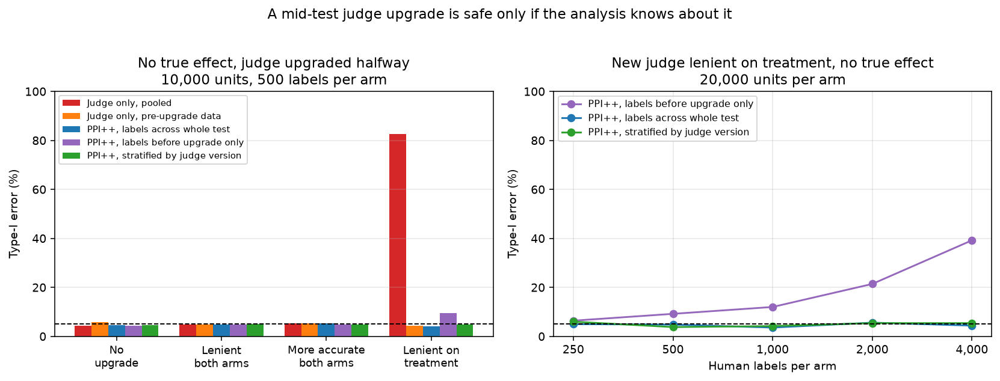

# Judge drift mid-test: simulation results

<!-- Generated by scripts/judge_drift_sim.py. Do not edit by hand. -->

Reproduce from a clean checkout:

```bash
pip install -e ".[dev]"
python scripts/judge_drift_sim.py
```

Seed `20261127`. No model API calls. True quality is binary with control rate 0.60; the true effect is +0.03 or 0 and doesn't change over time. The old judge has sensitivity = specificity = 0.85 on both arms. Halfway through the test, both arms switch to a new judge (sensitivity/specificity): *No upgrade*: treatment 0.85/0.85, control 0.85/0.85; *New judge more lenient on both arms*: treatment 0.85/0.75, control 0.85/0.75; *New judge more accurate on both arms*: treatment 0.92/0.92, control 0.92/0.92; *New judge more lenient on treatment only*: treatment 0.85/0.75, control 0.85/0.85. Every unit is judged; human labels are the same budget for every PPI++ variant. Values in parentheses are closed-form answers from `experiment_toolkit.judge_drift` (large-sample for "labels before upgrade only"). PPI++ variants with labels spread across the test or stratified by judge version are unbiased by construction, so their expected value is the true effect. Monte Carlo SE of a rate near 0.05 is about 0.005.



## 1. Every analysis against the truth (10,000 units and 500 human labels per arm, 2,000 replications)

| Judge upgrade | True effect | Analysis | Mean estimate (expected) | Emp. SD | Mean SE | Coverage | Rejects 0 (expected) |
|---|---:|---|---:|---:|---:|---:|---:|
| No upgrade | +0.00 | Judge only, pooled | +0.0003 (+0.0000) | 0.0069 | 0.0070 | 0.956 | 0.044 (0.050) |
| No upgrade | +0.00 | Judge only, pre-upgrade data | +0.0003 (+0.0000) | 0.0100 | 0.0099 | 0.943 | 0.058 (0.050) |
| No upgrade | +0.00 | PPI++, labels across whole test | -0.0003 (+0.0000) | 0.0222 | 0.0228 | 0.954 | 0.046 |
| No upgrade | +0.00 | PPI++, labels before upgrade only | +0.0004 (+0.0000) | 0.0220 | 0.0228 | 0.956 | 0.044 |
| No upgrade | +0.00 | PPI++, stratified by judge version | +0.0006 (+0.0000) | 0.0226 | 0.0228 | 0.954 | 0.046 |
| No upgrade | +0.03 | Judge only, pooled | +0.0212 (+0.0210) | 0.0069 | 0.0070 | 0.764 | 0.866 (0.853) |
| No upgrade | +0.03 | Judge only, pre-upgrade data | +0.0211 (+0.0210) | 0.0098 | 0.0099 | 0.857 | 0.584 (0.567) |
| No upgrade | +0.03 | PPI++, labels across whole test | +0.0296 (+0.0300) | 0.0227 | 0.0227 | 0.952 | 0.254 |
| No upgrade | +0.03 | PPI++, labels before upgrade only | +0.0303 (+0.0300) | 0.0228 | 0.0227 | 0.952 | 0.261 |
| No upgrade | +0.03 | PPI++, stratified by judge version | +0.0305 (+0.0300) | 0.0233 | 0.0227 | 0.945 | 0.273 |
| New judge more lenient on both arms | +0.00 | Judge only, pooled | -0.0000 (+0.0000) | 0.0070 | 0.0070 | 0.951 | 0.049 (0.050) |
| New judge more lenient on both arms | +0.00 | Judge only, pre-upgrade data | +0.0001 (+0.0000) | 0.0100 | 0.0099 | 0.951 | 0.049 (0.050) |
| New judge more lenient on both arms | +0.00 | PPI++, labels across whole test | -0.0004 (+0.0000) | 0.0238 | 0.0240 | 0.952 | 0.048 |
| New judge more lenient on both arms | +0.00 | PPI++, labels before upgrade only | +0.0015 (+0.0000) | 0.0225 | 0.0228 | 0.953 | 0.048 |
| New judge more lenient on both arms | +0.00 | PPI++, stratified by judge version | +0.0002 (+0.0000) | 0.0242 | 0.0239 | 0.949 | 0.051 |
| New judge more lenient on both arms | +0.03 | Judge only, pooled | +0.0196 (+0.0195) | 0.0069 | 0.0069 | 0.674 | 0.819 (0.804) |
| New judge more lenient on both arms | +0.03 | Judge only, pre-upgrade data | +0.0210 (+0.0210) | 0.0096 | 0.0099 | 0.864 | 0.570 (0.567) |
| New judge more lenient on both arms | +0.03 | PPI++, labels across whole test | +0.0299 (+0.0300) | 0.0244 | 0.0239 | 0.944 | 0.239 |
| New judge more lenient on both arms | +0.03 | PPI++, labels before upgrade only | +0.0291 (+0.0288) | 0.0228 | 0.0227 | 0.950 | 0.249 |
| New judge more lenient on both arms | +0.03 | PPI++, stratified by judge version | +0.0304 (+0.0300) | 0.0244 | 0.0238 | 0.949 | 0.257 |
| New judge more accurate on both arms | +0.00 | Judge only, pooled | -0.0002 (+0.0000) | 0.0071 | 0.0070 | 0.947 | 0.053 (0.050) |
| New judge more accurate on both arms | +0.00 | Judge only, pre-upgrade data | -0.0002 (+0.0000) | 0.0101 | 0.0099 | 0.946 | 0.054 (0.050) |
| New judge more accurate on both arms | +0.00 | PPI++, labels across whole test | +0.0003 (+0.0000) | 0.0207 | 0.0206 | 0.948 | 0.052 |
| New judge more accurate on both arms | +0.00 | PPI++, labels before upgrade only | -0.0006 (+0.0000) | 0.0231 | 0.0228 | 0.953 | 0.048 |
| New judge more accurate on both arms | +0.00 | PPI++, stratified by judge version | +0.0009 (+0.0000) | 0.0205 | 0.0205 | 0.952 | 0.048 |
| New judge more accurate on both arms | +0.03 | Judge only, pooled | +0.0231 (+0.0231) | 0.0070 | 0.0070 | 0.841 | 0.910 (0.913) |
| New judge more accurate on both arms | +0.03 | Judge only, pre-upgrade data | +0.0206 (+0.0210) | 0.0099 | 0.0099 | 0.837 | 0.564 (0.567) |
| New judge more accurate on both arms | +0.03 | PPI++, labels across whole test | +0.0292 (+0.0300) | 0.0212 | 0.0206 | 0.944 | 0.295 |
| New judge more accurate on both arms | +0.03 | PPI++, labels before upgrade only | +0.0314 (+0.0314) | 0.0228 | 0.0227 | 0.949 | 0.284 |
| New judge more accurate on both arms | +0.03 | PPI++, stratified by judge version | +0.0301 (+0.0300) | 0.0209 | 0.0204 | 0.942 | 0.321 |
| New judge more lenient on treatment only | +0.00 | Judge only, pooled | +0.0201 (+0.0200) | 0.0068 | 0.0070 | 0.174 | 0.826 (0.818) |
| New judge more lenient on treatment only | +0.00 | Judge only, pre-upgrade data | +0.0001 (+0.0000) | 0.0097 | 0.0099 | 0.956 | 0.044 (0.050) |
| New judge more lenient on treatment only | +0.00 | PPI++, labels across whole test | +0.0014 (+0.0000) | 0.0228 | 0.0234 | 0.958 | 0.042 |
| New judge more lenient on treatment only | +0.00 | PPI++, labels before upgrade only | +0.0141 (+0.0139) | 0.0224 | 0.0228 | 0.905 | 0.095 |
| New judge more lenient on treatment only | +0.00 | PPI++, stratified by judge version | +0.0003 (+0.0000) | 0.0239 | 0.0234 | 0.951 | 0.050 |
| New judge more lenient on treatment only | +0.03 | Judge only, pooled | +0.0395 (+0.0395) | 0.0071 | 0.0070 | 0.723 | 1.000 (1.000) |
| New judge more lenient on treatment only | +0.03 | Judge only, pre-upgrade data | +0.0208 (+0.0210) | 0.0100 | 0.0099 | 0.847 | 0.564 (0.567) |
| New judge more lenient on treatment only | +0.03 | PPI++, labels across whole test | +0.0305 (+0.0300) | 0.0232 | 0.0233 | 0.947 | 0.259 |
| New judge more lenient on treatment only | +0.03 | PPI++, labels before upgrade only | +0.0421 (+0.0427) | 0.0221 | 0.0227 | 0.918 | 0.453 |
| New judge more lenient on treatment only | +0.03 | PPI++, stratified by judge version | +0.0308 (+0.0300) | 0.0233 | 0.0233 | 0.946 | 0.261 |

## 2. More labels make front-loaded labeling worse (20,000 units per arm, new judge lenient on treatment only, no true effect, 500 replications per row)

The bias of labels-before-upgrade-only doesn't shrink with more labels, but its standard error does.

| Labels per arm | PPI++, labels before upgrade only: Type-I | PPI++, labels across whole test: Type-I | PPI++, stratified by judge version: Type-I | Labels-before-upgrade bias (expected) |
|---:|---:|---:|---:|---:|
| 250 | 0.064 | 0.050 | 0.060 | +0.0137 (+0.0139) |
| 500 | 0.092 | 0.048 | 0.038 | +0.0140 (+0.0139) |
| 1,000 | 0.120 | 0.036 | 0.042 | +0.0139 (+0.0139) |
| 2,000 | 0.214 | 0.056 | 0.054 | +0.0131 (+0.0139) |
| 4,000 | 0.392 | 0.044 | 0.054 | +0.0142 (+0.0139) |
