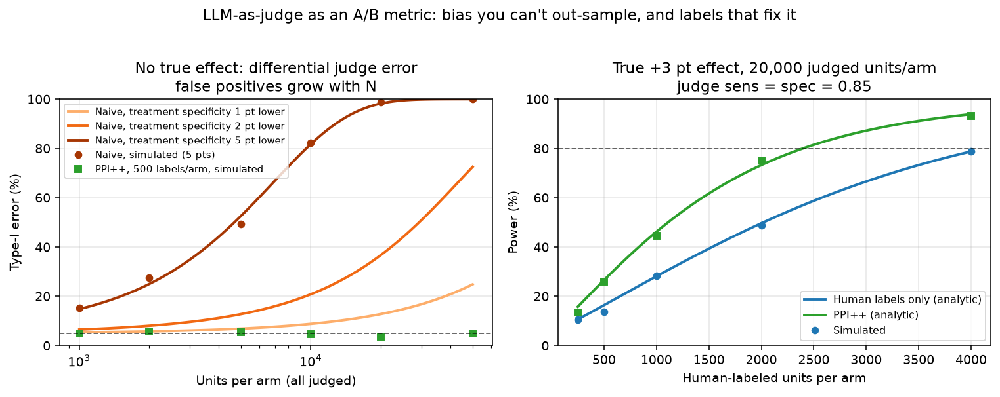

# LLM-as-judge noise in A/B tests: simulation results

<!-- Generated by scripts/llm_judge_sim.py. Do not edit by hand. -->

Reproduce from a clean checkout:

```bash
pip install -e ".[dev]"
python scripts/llm_judge_sim.py
```

Seed `20261126`. No model API calls. True quality is Bernoulli (control rate 0.60). The judge is a per-arm confusion matrix, so the true effect is known by construction. Values in parentheses are the closed-form answers from `experiment_toolkit.llm_judge`. Estimators:

- **Naive judge**: difference in mean judge score over all units.
- **Human labels only**: difference in mean human label over the labeled subsample.
- **PPI++**: prediction-powered inference with a power-tuned weight, using the human labels in each arm to correct the judge (Angelopoulos et al. 2023).



## 1. Bias, Type-I error, power and coverage (5,000 judged units and 500 human labels per arm, 2,000 replications)

Noisy judge: sensitivity = specificity = 0.85. Lenient judge on treatment: specificity 0.80. Monte Carlo SE of a rejection rate near 0.05 is about 0.005.

| Scenario | True effect | Estimator | Mean estimate (expected) | SD (expected SE) | Reject rate (expected) | 95% CI coverage |
|---|---:|---|---:|---:|---:|---:|
| Perfect judge | 0.00 | Naive judge | +0.0002 (+0.0000) | 0.0097 (0.0098) | 0.048 (0.050) | 0.953 |
| Perfect judge | 0.00 | Human labels only | +0.0008 (+0.0000) | 0.0311 (0.0310) | 0.050 (0.050) | 0.951 |
| Perfect judge | 0.00 | PPI++ | +0.0002 (+0.0000) | 0.0098 (0.0098) | 0.051 (0.050) | 0.949 |
| Perfect judge | 0.03 | Naive judge | +0.0298 (+0.0300) | 0.0101 (0.0097) | 0.853 (0.870) | 0.945 |
| Perfect judge | 0.03 | Human labels only | +0.0293 (+0.0300) | 0.0313 (0.0308) | 0.168 (0.164) | 0.942 |
| Perfect judge | 0.03 | PPI++ | +0.0300 (+0.0300) | 0.0101 (0.0097) | 0.857 (0.870) | 0.942 |
| Noisy judge, same in both arms | 0.00 | Naive judge | +0.0000 (+0.0000) | 0.0098 (0.0099) | 0.044 (0.050) | 0.956 |
| Noisy judge, same in both arms | 0.00 | Human labels only | +0.0004 (+0.0000) | 0.0306 (0.0310) | 0.041 (0.050) | 0.960 |
| Noisy judge, same in both arms | 0.00 | PPI++ | +0.0003 (+0.0000) | 0.0230 (0.0234) | 0.048 (0.050) | 0.953 |
| Noisy judge, same in both arms | 0.03 | Naive judge | +0.0209 (+0.0210) | 0.0101 (0.0099) | 0.586 (0.567) | 0.839 |
| Noisy judge, same in both arms | 0.03 | Human labels only | +0.0303 (+0.0300) | 0.0315 (0.0308) | 0.178 (0.164) | 0.950 |
| Noisy judge, same in both arms | 0.03 | PPI++ | +0.0294 (+0.0300) | 0.0238 (0.0233) | 0.246 (0.252) | 0.942 |
| Judge 5 pts more lenient on treatment | 0.00 | Naive judge | +0.0205 (+0.0200) | 0.0100 (0.0099) | 0.552 (0.527) | 0.448 |
| Judge 5 pts more lenient on treatment | 0.00 | Human labels only | +0.0020 (+0.0000) | 0.0300 (0.0310) | 0.038 (0.050) | 0.962 |
| Judge 5 pts more lenient on treatment | 0.00 | PPI++ | +0.0016 (+0.0000) | 0.0237 (0.0239) | 0.043 (0.050) | 0.957 |
| Judge 5 pts more lenient on treatment | 0.03 | Naive judge | +0.0390 (+0.0395) | 0.0099 (0.0098) | 0.976 (0.980) | 0.853 |
| Judge 5 pts more lenient on treatment | 0.03 | Human labels only | +0.0295 (+0.0300) | 0.0299 (0.0308) | 0.155 (0.164) | 0.955 |
| Judge 5 pts more lenient on treatment | 0.03 | PPI++ | +0.0297 (+0.0300) | 0.0232 (0.0238) | 0.237 (0.243) | 0.959 |

## 2. Differential error: Type-I error grows with sample size

No true effect. The judge is 0.05 less specific on treatment. PPI++ uses 500 human labels per arm. 500 replications per row.

| Units per arm | Naive (expected) | PPI++ |
|---:|---:|---:|
| 1,000 | 0.154 (0.148) | 0.048 |
| 2,000 | 0.276 (0.249) | 0.058 |
| 5,000 | 0.492 (0.527) | 0.054 |
| 10,000 | 0.822 (0.818) | 0.046 |
| 20,000 | 0.988 (0.982) | 0.036 |
| 50,000 | 1.000 (1.000) | 0.050 |

## 3. Non-differential noise: extra sample the naive metric needs

Analytic. True effect +0.03 on a 0.60 base rate, two-sided alpha = 0.05, power = 0.8. With a perfect metric the requirement is 4,126 per arm. These multipliers apply only when the judge errs the same way in both arms. Under differential error, no sample size fixes the bias (section 2).

| Judge sensitivity = specificity | Youden J | Sample-size multiplier | Per-arm n for 80% power |
|---:|---:|---:|---:|
| 1.00 | 1.00 | 1.00x | 4,126 |
| 0.95 | 0.90 | 1.25x | 5,149 |
| 0.90 | 0.80 | 1.59x | 6,579 |
| 0.85 | 0.70 | 2.10x | 8,665 |
| 0.80 | 0.60 | 2.88x | 11,878 |
| 0.70 | 0.40 | 6.55x | 27,019 |

## 4. Human labels needed for 80% power (20,000 judged units per arm)

Analytic. True effect +0.03. PPI++ remains unbiased under differential error, as long as the labels are a random sample within each arm.

| Judge sensitivity = specificity | Corr(judge, human) | Human labels only | PPI++ labels | Label saving |
|---:|---:|---:|---:|---:|
| 0.95 | 0.90 | 4,126 | 982 | 76% |
| 0.90 | 0.79 | 4,126 | 1,767 | 57% |
| 0.85 | 0.69 | 4,126 | 2,397 | 42% |
| 0.80 | 0.59 | 4,126 | 2,901 | 30% |
| 0.70 | 0.39 | 4,126 | 3,610 | 13% |

Simulated power at sensitivity = specificity = 0.85 (500 replications per row):

| Labels per arm | Human only | PPI++ |
|---:|---:|---:|
| 250 | 0.106 | 0.134 |
| 500 | 0.138 | 0.260 |
| 1,000 | 0.282 | 0.444 |
| 2,000 | 0.488 | 0.750 |
| 4,000 | 0.788 | 0.932 |
