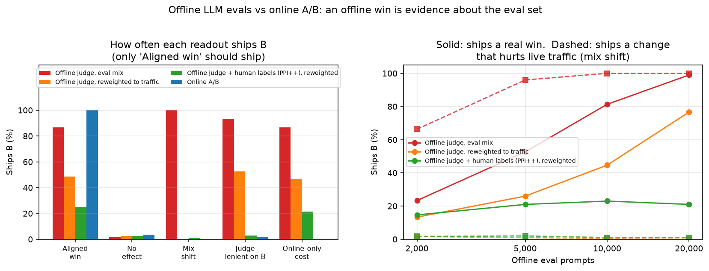

# Offline LLM evals vs online A/B: simulation results

<!-- Generated by scripts/offline_online_sim.py. Do not edit by hand. -->

Reproduce from a clean checkout:

```bash
pip install -e ".[dev]"
python scripts/offline_online_sim.py
```

Seed `20261127`. No model API calls. Segment shares, eval set vs live traffic: chat 20% vs 70% / coding 60% vs 20% / reasoning 20% vs 10%. Baseline quality by segment: 0.60, 0.50, 0.40. Judge sensitivity = specificity = 0.85 for A's outputs; in the lenient scenario its specificity on B's outputs is 0.80. Online success = 0.1 + 0.8 x quality - online cost. A readout **ships** when its 95% CI is above 0 and **stops** when it is below 0. Values in parentheses are closed-form expectations from `experiment_toolkit.offline_eval`. The three offline estimates are in different units (judged rate, judged rate, true quality), so compare their signs and decisions with the online effect, not their sizes.



## 1. Which readouts ship B (10,000 eval prompts, 1,000 human-labeled, 200,000 online users per arm, 500 replications)

| Scenario | True online effect (call) | Method | Mean estimate (expected) | Ships | Stops | No decision |
|---|---:|---|---:|---:|---:|---:|
| Aligned win | +0.0240 (ship) | Offline judge, eval mix | +0.0211 (+0.0210) | 87% | 0% | 13% |
| Aligned win | +0.0240 (ship) | Offline judge, reweighted to traffic | +0.0213 (+0.0210) | 49% | 0% | 51% |
| Aligned win | +0.0240 (ship) | Offline judge + human labels (PPI++), reweighted | +0.0312 (+0.0300) | 25% | 0% | 75% |
| Aligned win | +0.0240 (ship) | Online A/B | +0.0241 (+0.0240) | 100% | 0% | 0% |
| No effect | +0.0000 (don't ship) | Offline judge, eval mix | -0.0004 (+0.0000) | 1% | 2% | 96% |
| No effect | +0.0000 (don't ship) | Offline judge, reweighted to traffic | -0.0004 (+0.0000) | 3% | 3% | 94% |
| No effect | +0.0000 (don't ship) | Offline judge + human labels (PPI++), reweighted | +0.0002 (+0.0000) | 3% | 3% | 95% |
| No effect | +0.0000 (don't ship) | Online A/B | +0.0000 (+0.0000) | 3% | 2% | 94% |
| Mix shift (B helps coding, hurts chat) | -0.0064 (stop) | Offline judge, eval mix | +0.0362 (+0.0364) | 100% | 0% | 0% |
| Mix shift (B helps coding, hurts chat) | -0.0064 (stop) | Offline judge, reweighted to traffic | -0.0064 (-0.0056) | 0% | 8% | 92% |
| Mix shift (B helps coding, hurts chat) | -0.0064 (stop) | Offline judge + human labels (PPI++), reweighted | -0.0085 (-0.0080) | 1% | 6% | 92% |
| Mix shift (B helps coding, hurts chat) | -0.0064 (stop) | Online A/B | -0.0064 (-0.0064) | 0% | 99% | 1% |
| Judge lenient on B, no true effect | +0.0000 (don't ship) | Offline judge, eval mix | +0.0253 (+0.0250) | 93% | 0% | 7% |
| Judge lenient on B, no true effect | +0.0000 (don't ship) | Offline judge, reweighted to traffic | +0.0225 (+0.0220) | 53% | 0% | 47% |
| Judge lenient on B, no true effect | +0.0000 (don't ship) | Offline judge + human labels (PPI++), reweighted | +0.0022 (+0.0000) | 3% | 3% | 94% |
| Judge lenient on B, no true effect | +0.0000 (don't ship) | Online A/B | +0.0000 (+0.0000) | 2% | 3% | 95% |
| Online-only cost (B adds latency) | -0.0060 (stop) | Offline judge, eval mix | +0.0216 (+0.0210) | 87% | 0% | 13% |
| Online-only cost (B adds latency) | -0.0060 (stop) | Offline judge, reweighted to traffic | +0.0214 (+0.0210) | 47% | 0% | 53% |
| Online-only cost (B adds latency) | -0.0060 (stop) | Offline judge + human labels (PPI++), reweighted | +0.0297 (+0.0300) | 22% | 0% | 78% |
| Online-only cost (B adds latency) | -0.0060 (stop) | Online A/B | -0.0060 (-0.0060) | 0% | 96% | 4% |

## 2. Offline eval size: power vs protection

1,000 human-labeled prompts at every size. 300 replications per row. Reweighting to the traffic mix leans on the chat segment, which is only 20% of the eval set, so it needs more prompts for the same power.

| Eval prompts | Method | Ships a real win (aligned) | Ships a change that hurts traffic (mix shift) |
|---:|---|---:|---:|
| 2,000 | Offline judge, eval mix | 23% | 66% |
| 2,000 | Offline judge, reweighted to traffic | 13% | 2% |
| 2,000 | Offline judge + human labels (PPI++), reweighted | 15% | 2% |
| 5,000 | Offline judge, eval mix | 53% | 96% |
| 5,000 | Offline judge, reweighted to traffic | 26% | 1% |
| 5,000 | Offline judge + human labels (PPI++), reweighted | 21% | 2% |
| 10,000 | Offline judge, eval mix | 81% | 100% |
| 10,000 | Offline judge, reweighted to traffic | 45% | 0% |
| 10,000 | Offline judge + human labels (PPI++), reweighted | 23% | 1% |
| 20,000 | Offline judge, eval mix | 99% | 100% |
| 20,000 | Offline judge, reweighted to traffic | 77% | 0% |
| 20,000 | Offline judge + human labels (PPI++), reweighted | 21% | 1% |
