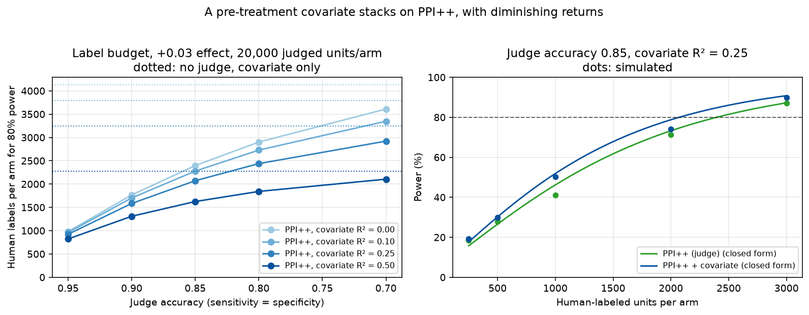

# PPI++ with a pre-treatment covariate: simulation results

<!-- Generated by scripts/ppi_covariates_sim.py. Do not edit by hand. -->

Reproduce from a clean checkout:

```bash
pip install -e ".[dev]"
python scripts/ppi_covariates_sim.py
```

Seed `20261127`. No model API calls. True quality is binary with control rate 0.60; the true effect is +0.03 or 0. The covariate X is a binary pre-treatment attribute known for every unit (for example a difficulty bucket), set so that it explains a chosen share R²(Y; X) of the variance of true quality. The judge errs on Y only, so X and the judge score are independent given Y. Every unit is judged; human labels go to a random sample within each arm. Values in parentheses are closed-form answers from `experiment_toolkit.ppi_covariates`.

The closed form for PPI++ alone reproduces loop 1's label budgets exactly (see `tests/test_ppi_covariates.py`).



## 1. Known-answer check (20,000 judged units, 500 labels per arm, judge accuracy 0.85, R²(Y; X) = 0.25, 2,000 replications)

R²(Y; judge) = 0.480; R²(Y; judge, X) = 0.557. Monte Carlo SE of a rejection rate near 0.05 is about 0.005.

| Scenario | Estimator | Mean estimate (truth) | SD (expected SE) | Reject rate (expected) | 95% CI coverage |
|---|---|---:|---:|---:|---:|
| No effect | Human labels only | +0.0000 (+0.0000) | 0.0305 (0.0310) | 0.045 (0.050) | 0.955 |
| No effect | Human labels + covariate | +0.0001 (+0.0000) | 0.0263 (0.0269) | 0.044 (0.050) | 0.956 |
| No effect | PPI++ (judge) | -0.0009 (+0.0000) | 0.0225 (0.0226) | 0.044 (0.050) | 0.956 |
| No effect | PPI++ + covariate | -0.0007 (+0.0000) | 0.0208 (0.0210) | 0.046 (0.050) | 0.954 |
| True effect +0.03 | Human labels only | +0.0294 (+0.0300) | 0.0309 (0.0308) | 0.163 (0.164) | 0.955 |
| True effect +0.03 | Human labels + covariate | +0.0297 (+0.0300) | 0.0266 (0.0267) | 0.201 (0.203) | 0.957 |
| True effect +0.03 | PPI++ (judge) | +0.0300 (+0.0300) | 0.0227 (0.0225) | 0.268 (0.266) | 0.951 |
| True effect +0.03 | PPI++ + covariate | +0.0300 (+0.0300) | 0.0207 (0.0208) | 0.316 (0.302) | 0.954 |
| No effect, judge 5 pts more lenient on treatment | Human labels only | +0.0004 (+0.0000) | 0.0318 (0.0310) | 0.056 (0.050) | 0.945 |
| No effect, judge 5 pts more lenient on treatment | Human labels + covariate | +0.0005 (+0.0000) | 0.0274 (0.0269) | 0.053 (0.050) | 0.947 |
| No effect, judge 5 pts more lenient on treatment | PPI++ (judge) | +0.0007 (+0.0000) | 0.0243 (0.0232) | 0.063 (0.050) | 0.937 |
| No effect, judge 5 pts more lenient on treatment | PPI++ + covariate | +0.0007 (+0.0000) | 0.0223 (0.0214) | 0.060 (0.050) | 0.940 |

## 2. Small label budgets: does estimating an extra weight cost coverage?

No effect; 20,000 judged units per arm; 2,000 replications per row.

| Labels per arm | PPI++ coverage | PPI++ + covariate coverage | PPI++ Type-I | PPI++ + covariate Type-I |
|---:|---:|---:|---:|---:|
| 30 | 0.934 | 0.923 | 0.066 | 0.076 |
| 100 | 0.952 | 0.944 | 0.049 | 0.057 |
| 300 | 0.952 | 0.949 | 0.048 | 0.051 |

## 3. Human labels per arm for 80% power (20,000 judged units per arm, effect +0.03)

Closed form. R²(Y; X) = 0.00 is PPI++ alone (loop 1). Other columns add the covariate.

| Judge accuracy (sens = spec) | R²(Y; judge) | R²(Y; X) = 0.00 | R²(Y; X) = 0.10 | R²(Y; X) = 0.25 | R²(Y; X) = 0.50 |
|---:|---:|---:|---:|---:|---:|
| no judge | — | 4,126 | 3,787 | 3,250 | 2,271 |
| 0.95 | 0.80 | 982 | 962 | 923 | 822 |
| 0.90 | 0.63 | 1,767 | 1,702 | 1,584 | 1,309 |
| 0.85 | 0.48 | 2,397 | 2,278 | 2,072 | 1,625 |
| 0.80 | 0.35 | 2,901 | 2,729 | 2,439 | 1,842 |
| 0.70 | 0.15 | 3,610 | 3,348 | 2,921 | 2,105 |

Label saving from adding the covariate, relative to the same row at R²(Y; X) = 0.00:

| Judge accuracy (sens = spec) | R²(Y; X) = 0.10 | R²(Y; X) = 0.25 | R²(Y; X) = 0.50 |
|---:|---:|---:|---:|
| no judge | 8% | 21% | 45% |
| 0.95 | 2% | 6% | 16% |
| 0.90 | 4% | 10% | 26% |
| 0.85 | 5% | 14% | 32% |
| 0.80 | 6% | 16% | 37% |
| 0.70 | 7% | 19% | 42% |

## 4. Small arms cap the gain (judge accuracy 0.85, R²(Y; X) = 0.25)

Closed form. The variance reduction is R² × N / (N + n), so the gain shrinks when labels are a large share of the arm.

| Judged units per arm | PPI++ labels | PPI++ + covariate labels | Saving | Labels as share of arm (PPI++) |
|---:|---:|---:|---:|---:|
| 5,000 | 3,561 | 3,387 | 5% | 71% |
| 20,000 | 2,397 | 2,072 | 14% | 12% |
| 100,000 | 2,205 | 1,878 | 15% | 2% |

## 5. Simulated power vs labels (judge accuracy 0.85, R²(Y; X) = 0.25, 500 replications per row)

| Labels per arm | PPI++ (expected) | PPI++ + covariate (expected) |
|---:|---:|---:|
| 250 | 0.184 (0.157) | 0.192 (0.177) |
| 500 | 0.278 (0.266) | 0.298 (0.302) |
| 1,000 | 0.410 (0.462) | 0.502 (0.519) |
| 2,000 | 0.712 (0.733) | 0.740 (0.788) |
| 3,000 | 0.870 (0.872) | 0.898 (0.908) |
