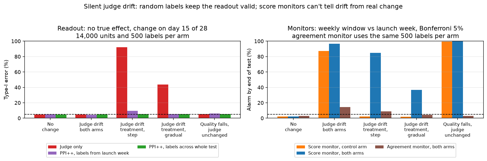

# Silent judge drift: simulation results

<!-- Generated by scripts/silent_drift_sim.py. Do not edit by hand. -->

Reproduce from a clean checkout:

```bash
pip install -e ".[dev]"
python scripts/silent_drift_sim.py
```

Seed `20261127`. No model API calls. A 28-day test with 500 units per arm per day (14,000 per arm). True quality is binary with control rate 0.60; the true effect is +0.03 or 0. The judge starts at sensitivity = specificity = 0.85 on both arms. From day 15, with no version flag, the judge's specificity drops to 0.75 (more lenient) on the arms named in the scenario, either at once (step) or linearly until day 28 (gradual). In the last scenario the judge never changes but true quality falls by 0.08 on both arms from day 15, so the true effect is unchanged. Human labels: 500 per arm, drawn either from the first 7 days (launch week) or at random from the whole test, which can be done at the end from logged outputs. Values in parentheses are closed-form answers from `experiment_toolkit.judge_drift` (large-sample for launch-week labels); PPI++ with labels across the whole test is unbiased by construction. Monte Carlo SE of a rate near 0.05 is about 0.005.

Monitors compare each day's latest 7-day window with the first 7 days, from day 14 to day 28 (15 checks), with a two-sample z-test whose threshold is Bonferroni-corrected over every check and series, so the chance of any false alarm is at most 0.05 when nothing changes. The *score monitor* tracks the judge's pass rate on all units (control arm only, or each arm). The *agreement monitor* tracks, in each arm, the judge's pass rate among labeled units humans passed and among those humans failed (sensitivity and false-positive rate), using the labels spread across the test. "Median days after change" counts the changed days seen when the alarm fires (day of alarm − 14).



## 1. Readouts against the truth (2,000 replications)

| Scenario | True effect | Analysis | Mean estimate (expected) | Emp. SD | Mean SE | Coverage | Rejects 0 |
|---|---:|---|---:|---:|---:|---:|---:|
| No change | +0.00 | Judge only | +0.0000 (+0.0000) | 0.0059 | 0.0059 | 0.953 | 0.048 |
| No change | +0.00 | PPI++, labels from launch week | -0.0007 (+0.0000) | 0.0224 | 0.0227 | 0.951 | 0.050 |
| No change | +0.00 | PPI++, labels across whole test | -0.0003 (+0.0000) | 0.0227 | 0.0227 | 0.953 | 0.048 |
| No change | +0.03 | Judge only | +0.0208 (+0.0210) | 0.0058 | 0.0059 | 0.647 | 0.947 |
| No change | +0.03 | PPI++, labels from launch week | +0.0305 (+0.0300) | 0.0229 | 0.0226 | 0.948 | 0.276 |
| No change | +0.03 | PPI++, labels across whole test | +0.0299 (+0.0300) | 0.0230 | 0.0226 | 0.944 | 0.271 |
| Judge drifts on both arms (step) | +0.00 | Judge only | -0.0000 (+0.0000) | 0.0058 | 0.0059 | 0.954 | 0.046 |
| Judge drifts on both arms (step) | +0.00 | PPI++, labels from launch week | -0.0001 (+0.0000) | 0.0226 | 0.0227 | 0.956 | 0.044 |
| Judge drifts on both arms (step) | +0.00 | PPI++, labels across whole test | -0.0009 (+0.0000) | 0.0241 | 0.0239 | 0.952 | 0.049 |
| Judge drifts on both arms (step) | +0.03 | Judge only | +0.0194 (+0.0195) | 0.0057 | 0.0059 | 0.574 | 0.914 |
| Judge drifts on both arms (step) | +0.03 | PPI++, labels from launch week | +0.0285 (+0.0288) | 0.0226 | 0.0226 | 0.952 | 0.248 |
| Judge drifts on both arms (step) | +0.03 | PPI++, labels across whole test | +0.0299 (+0.0300) | 0.0236 | 0.0238 | 0.944 | 0.247 |
| Judge drifts on treatment only (step) | +0.00 | Judge only | +0.0201 (+0.0200) | 0.0059 | 0.0059 | 0.077 | 0.922 |
| Judge drifts on treatment only (step) | +0.00 | PPI++, labels from launch week | +0.0139 (+0.0139) | 0.0232 | 0.0227 | 0.903 | 0.097 |
| Judge drifts on treatment only (step) | +0.00 | PPI++, labels across whole test | +0.0004 (+0.0000) | 0.0233 | 0.0233 | 0.948 | 0.052 |
| Judge drifts on treatment only (step) | +0.03 | Judge only | +0.0397 (+0.0395) | 0.0060 | 0.0059 | 0.614 | 1.000 |
| Judge drifts on treatment only (step) | +0.03 | PPI++, labels from launch week | +0.0434 (+0.0427) | 0.0231 | 0.0226 | 0.906 | 0.492 |
| Judge drifts on treatment only (step) | +0.03 | PPI++, labels across whole test | +0.0288 (+0.0300) | 0.0228 | 0.0231 | 0.956 | 0.242 |
| Judge drifts on treatment only (gradual) | +0.00 | Judge only | +0.0105 (+0.0107) | 0.0058 | 0.0059 | 0.565 | 0.435 |
| Judge drifts on treatment only (gradual) | +0.00 | PPI++, labels from launch week | +0.0070 (+0.0074) | 0.0221 | 0.0227 | 0.946 | 0.054 |
| Judge drifts on treatment only (gradual) | +0.00 | PPI++, labels across whole test | -0.0010 (+0.0000) | 0.0235 | 0.0230 | 0.947 | 0.053 |
| Judge drifts on treatment only (gradual) | +0.03 | Judge only | +0.0308 (+0.0309) | 0.0058 | 0.0059 | 0.941 | 1.000 |
| Judge drifts on treatment only (gradual) | +0.03 | PPI++, labels from launch week | +0.0365 (+0.0367) | 0.0225 | 0.0226 | 0.945 | 0.370 |
| Judge drifts on treatment only (gradual) | +0.03 | PPI++, labels across whole test | +0.0299 (+0.0300) | 0.0233 | 0.0229 | 0.949 | 0.264 |
| True quality falls, judge unchanged | +0.00 | Judge only | +0.0002 (+0.0000) | 0.0059 | 0.0060 | 0.948 | 0.052 |
| True quality falls, judge unchanged | +0.00 | PPI++, labels from launch week | +0.0000 (+0.0000) | 0.0230 | 0.0227 | 0.941 | 0.059 |
| True quality falls, judge unchanged | +0.00 | PPI++, labels across whole test | +0.0005 (+0.0000) | 0.0230 | 0.0228 | 0.947 | 0.053 |
| True quality falls, judge unchanged | +0.03 | Judge only | +0.0210 (+0.0210) | 0.0058 | 0.0059 | 0.673 | 0.943 |
| True quality falls, judge unchanged | +0.03 | PPI++, labels from launch week | +0.0308 (+0.0304) | 0.0232 | 0.0226 | 0.947 | 0.281 |
| True quality falls, judge unchanged | +0.03 | PPI++, labels across whole test | +0.0298 (+0.0300) | 0.0230 | 0.0228 | 0.949 | 0.266 |

## 2. Monitors (2,000 replications, same runs as section 1)

Closed form for one check on a fully changed week: the judge's pass rate on control moves from 0.570 to 0.610 when it turns lenient, so a single check flags with probability 0.681 (control-arm monitor) or 0.603 (both-arm monitor, stricter threshold).

| Scenario | True effect | Score monitor, control arm: alarm rate | Score monitor, control arm: median days after change | Score monitor, both arms: alarm rate | Score monitor, both arms: median days after change | Agreement monitor, both arms: alarm rate | Agreement monitor, both arms: median days after change |
|---|---:|---:|---:|---:|---:|---:|---:|
| No change | +0.00 | 0.022 | — | 0.022 | — | 0.031 | — |
| No change | +0.03 | 0.021 | — | 0.026 | — | 0.028 | — |
| Judge drifts on both arms (step) | +0.00 | 0.871 | 6 | 0.968 | 6 | 0.144 | 8 |
| Judge drifts on both arms (step) | +0.03 | 0.886 | 6 | 0.963 | 6 | 0.131 | 8 |
| Judge drifts on treatment only (step) | +0.00 | 0.021 | 5 | 0.847 | 6 | 0.089 | 7 |
| Judge drifts on treatment only (step) | +0.03 | 0.025 | 7 | 0.751 | 7 | 0.076 | 7 |
| Judge drifts on treatment only (gradual) | +0.00 | 0.019 | 7 | 0.365 | 12 | 0.043 | 9 |
| Judge drifts on treatment only (gradual) | +0.03 | 0.022 | 7 | 0.300 | 12 | 0.036 | 7 |
| True quality falls, judge unchanged | +0.00 | 0.993 | 5 | 1.000 | 4 | 0.029 | 6 |
| True quality falls, judge unchanged | +0.03 | 0.994 | 5 | 1.000 | 4 | 0.036 | 6 |

## 3. Labels the agreement monitor needs (500 replications per row, no true effect)

Labels are drawn at random across the whole test, as in section 1. To confirm a score alarm instead with a one-off label burst (launch week vs flagged week, two-sided 5% test of the judge's false-positive rate, 80% power) needs about 619 labels per arm in each of the two weeks (closed form).

| Labels per arm | Alarm rate, judge drifts on treatment only | Median days after change | One fully drifted week flags (closed form) | Alarm rate, quality falls with judge unchanged |
|---:|---:|---:|---:|---:|
| 500 | 0.076 | 6 | 0.019 | 0.030 |
| 1,000 | 0.180 | 7 | 0.059 | 0.032 |
| 2,000 | 0.398 | 7 | 0.206 | 0.030 |
| 4,000 | 0.788 | 6 | 0.588 | 0.016 |
| 8,000 | 0.986 | 5 | 0.955 | 0.034 |
